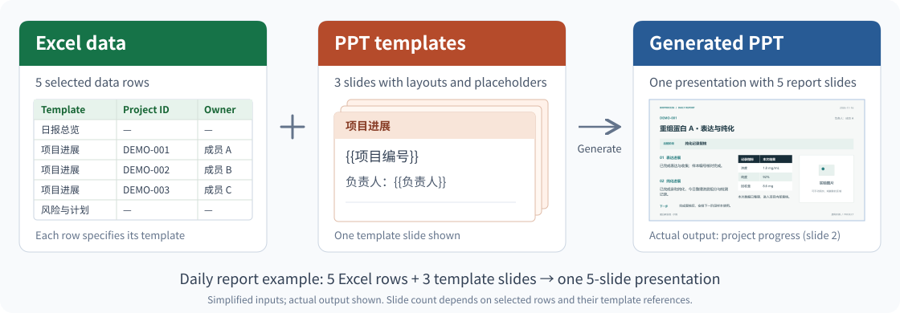
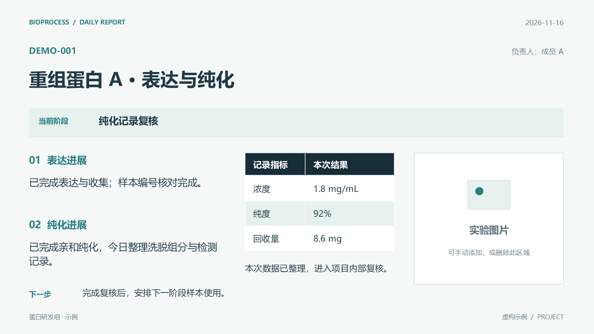
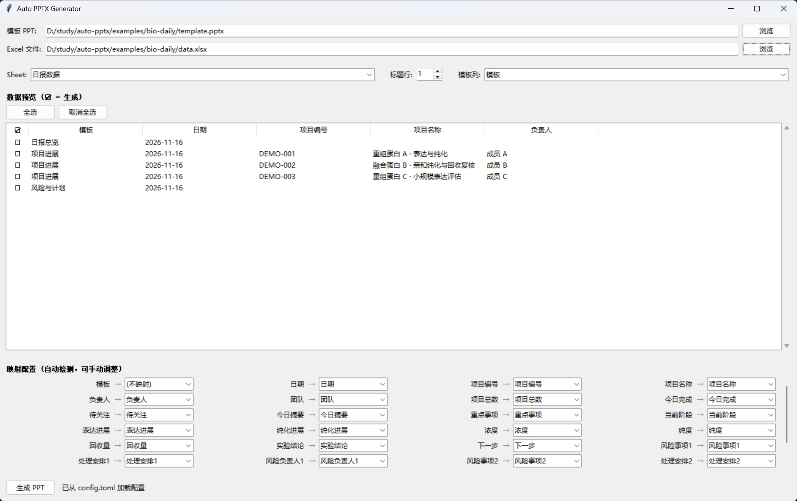

# auto-pptx

[简体中文](README.md) | English

A desktop tool that generates a single PowerPoint presentation from selected Excel rows using slide templates.

- Replace placeholders in text boxes and tables.
- Use multiple slide templates for each data row.
- Select the rows to include and save column mappings.

## Quick start

New to auto-pptx? Follow the [onboarding guide](docs/ai-onboarding.md#english) to open the public daily report sample, select only **Excel row 2**, and generate one Daily Overview slide. You don't need AI, source code, or Python.

When using your own `.pptx` template and matching `.xlsx` file:

1. Start the application and select the template and Excel file.
2. Confirm the worksheet, header row, template column, and **Excel column → PowerPoint placeholder** mappings.
3. Select the rows to include and click “生成 PPT” (Generate PowerPoint).

The screenshot shows the Chinese application interface on Windows. Click “全选” (Select all) or select individual rows before generating. See the [interface guide (Chinese)](docs/使用培训.md#界面说明) for a description of each area.

The output is saved **in the same folder as the Excel file**, named `output_YYYYMMDD_HHMMSS.pptx`. The “完成” (Complete) dialog and bottom status bar show the save path. The application interface is currently in Chinese.

## Troubleshoot with AI

In versions that support checks, click “检查当前设置” (Check current settings), then preview and copy a shareable summary. The [onboarding guide](docs/ai-onboarding.md#check-your-own-files-with-ai) has a prompt you can paste into a chat without uploading the original files. If your client supports Skills, you can use the optional [`auto-pptx-onboarding` Skill](docs/ai-onboarding.md#get-the-optional-skill).

## Documentation and contributing

- [Application users (Chinese)](docs/使用培训.md#软件使用者): fill in data, use the interface, generate reports, and troubleshoot.
- [Maintainers (Chinese)](docs/使用培训.md#维护人员): templates, Excel formats, and `config.toml`.
- [Contributing (Chinese)](CONTRIBUTING.md): run from source, test, and submit pull requests.
- [Development and build guide (Chinese)](docs/开发.md): modules, example maintenance, and packaging.

Issues and pull requests are welcome on GitHub. When reporting an issue, include the application version, reproduction steps, and a sanitized example.

## License

[MIT](LICENSE).
