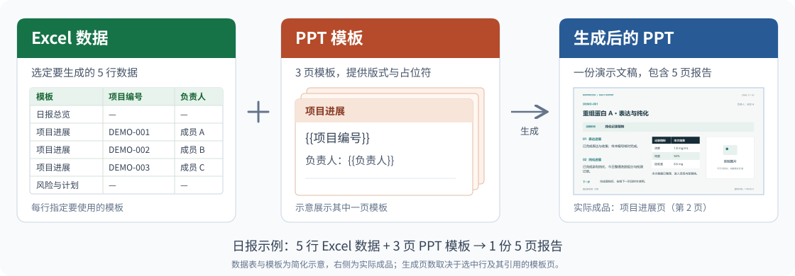
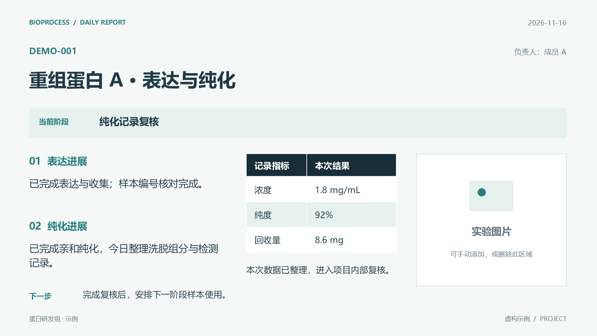
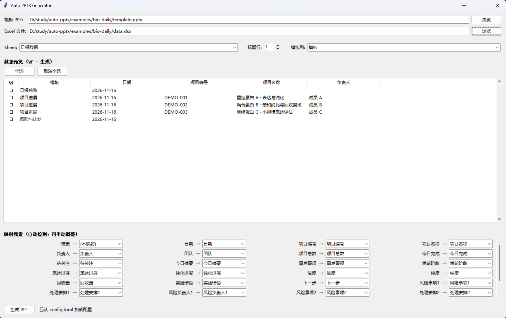

# auto-pptx

简体中文 | [English](README.en.md)

将选定的 Excel 数据按 PowerPoint 模板批量生成到一份演示文稿中的桌面工具。

- 支持文本框、表格中的占位符替换。
- 支持每行数据使用多个模板页。
- 可勾选需要生成的数据行，并保存列映射配置。

## 快速开始

第一次使用？跟着[入门指南](docs/ai-onboarding.md)打开公开日报样例，只勾选 **Excel 第 2 行**，生成一页「日报总览」。无需 AI、源码或 Python。

使用自己的配套 `.pptx` 模板和 `.xlsx` 文件时：

1. 启动软件，选择模板和 Excel 文件。
2. 确认工作表、标题行、模板列，以及 **Excel 列 → PPT 占位符**映射。
3. 点击“全选”或逐行勾选需要生成的数据行，再点击“生成 PPT”。

上图为 Windows 实际界面，各区域说明见[界面说明](docs/使用培训.md#界面说明)。

生成文件保存在 **Excel 所在目录**，名称为 `output_YYYYMMDD_HHMMSS.pptx`。“完成”对话框和底部状态栏会显示保存路径。

## 借助 AI 排错

在支持检查的版本中，先点「检查当前设置」，再预览并复制可分享的摘要。[入门指南](docs/ai-onboarding.md#借助-ai-检查自己的文件)提供可直接粘贴到聊天工具的提问示例，不用上传原始文件。已使用支持 Skills 的客户端？可选用 [`auto-pptx-onboarding` Skill](docs/ai-onboarding.md#获取可选-skill)。

## 文档与贡献

- [软件使用者](docs/使用培训.md#软件使用者)：填写数据、操作界面、生成与排错。
- [维护人员](docs/使用培训.md#维护人员)：模板、Excel 格式和 `config.toml`。
- [贡献指南](CONTRIBUTING.md)：从源码运行、测试与提交 PR。
- [开发与构建](docs/开发.md)：模块、示例维护与打包。

欢迎通过 GitHub Issue 反馈问题或提交 PR。反馈时请提供版本、复现步骤和脱敏后的示例。

## 许可证

[MIT](LICENSE)。
