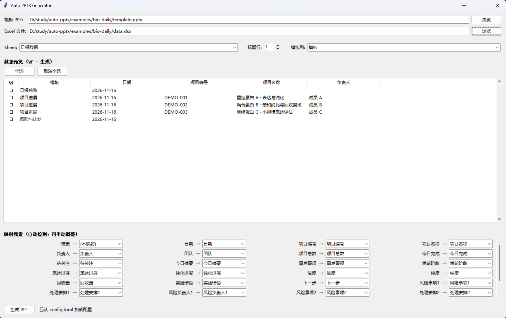

# 使用指南

将选定的 Excel 数据行填入 PowerPoint 模板，生成一份新的 `.pptx` 文件。

- 使用现成模板生成报告，阅读[软件使用者](#软件使用者)。
- 维护模板、Excel 格式和配置，阅读[维护人员](#维护人员)。

## 软件使用者

### 准备文件

准备维护人员提供的 `.pptx` 模板和配套 `.xlsx` 文件。按表格要求填写数据并保存，保留列名和模板名称。首次试用可跟随[日报示例](../examples/bio-daily/README.md)生成五页报告。

### 界面说明

下图为 Windows 实际界面：顶部选择文件与工作表，中部勾选数据，下方检查映射，底部生成报告。



图中数据行尚未勾选。表头的 `☑` 只是列标识，以各行状态为准。

### 生成报告

1. 启动软件，点击“浏览”，选择 `.pptx` 模板和 `.xlsx` 数据文件。
2. 按维护人员的说明确认“Sheet”“标题行”和“模板列”。日报示例分别选“日报数据”、`1` 和“模板”。
3. 确认 **Excel 列 → PPT 占位符**映射，如“项目编号 → 项目编号”；日报示例的“模板”列选“(不映射)”。不确定时请维护人员确认。
4. 点击数据行首列，将 `☐` 切换为 `☑`；也可用“全选”或“取消全选”操作当前数据。默认不勾选，生成前至少选择一行。
5. 点击“生成 PPT”，核对成品页数、内容，以及完成对话框中的跳过行、未匹配模板和未替换占位符警告。没有有效页面时，程序报错。

输出保存在 **Excel 所在目录**，名称为 `output_YYYYMMDD_HHMMSS.pptx`。“完成”对话框和底部状态栏会显示页数与保存路径。页面按 Excel 行号排序，同一行按模板列中的顺序生成。

悬停可查看截断文字，长提示支持滚动。映射区可滚动，拖动分隔线可调整高度。

选择 Excel 后默认打开第一个工作表。切换文件、工作表或标题行会清空勾选；切换模板列会保留仍有效的勾选行。

### 遇到问题

| 现象 | 处理 |
| --- | --- |
| 标题错位或缺少首行数据 | 修正标题行，再重新勾选 |
| 找不到模板、页面缺失或占位符未替换 | 将模板、Excel 文件与警告交给维护人员检查 |
| 未找到生成文件 | 查看“完成”对话框或底部状态栏中的路径，到 Excel 所在文件夹查找 |

反馈问题时，附成品、提示信息和脱敏后的输入文件。

## 维护人员

### 模板页与占位符

使用 `.pptx` 文件；旧版 `.ppt` 先另存为 `.pptx`。在每页普通文本框中添加模板标识，在文本框或表格单元格中添加数据占位符：

```text
{{tpl::项目进展}}
项目编号：{{项目编号}}
负责人：{{负责人}}
```

- **模板名**：区分大小写，支持中文、英文字母、数字、下划线和连字符，不含空格、斜杠或冒号。每页只识别首个标识；多页同名时只使用第一页。
- **页面保留**：生成器移除全部原始页面，只保留生成页。封面和目录也需添加标识，并由 Excel 引用。标识会保留在成品中，请放在画布外。
- **替换范围**：支持文本框和表格，不替换图片、图表数据、备注页和组合对象内部文字。图片需在模板或成品中手动插入。
- **文字格式**：占位符可跨同一段落的文字片段，不能跨段落；替换后整段沿用首个片段的格式。请统一样式，预留足够空间；溢出时缩短文字或扩大文本框。
- **空值与遗漏**：已映射的空单元格替换为空字符串；未映射的占位符保留原文并触发警告。

### 配套 Excel

使用 `.xlsx` 文件；旧版 `.xls` 先另存为 `.xlsx`。列名使用非空、唯一的单行文字；空列名不参与映射，重复的非空列名会阻止生成。

标题行是列名所在的 Excel 行号，从 1 开始，界面支持第 1～15 行。预览显示前五列，模板列不在其中时追加显示。

| 模板 | 项目编号 | 项目名称 |
| --- | --- | --- |
| 项目进展 | DEMO-001 | 重组蛋白 A |
| 日报总览 / 风险与计划 | | |

模板列名称不限，由使用者在界面指定。内容须与 `{{tpl::名称}}` 中的名称一致。一行引用多页时，用半角 `/` 分隔，程序忽略两侧空格并按填写顺序生成；全角 `／` 不能分隔模板名。

模板列为空或所有名称均未匹配时，跳过该行并提示；部分匹配时，生成匹配页并警告未匹配项。

日期、前导零和小数位请整理为最终展示文本，程序不保留 Excel 显示格式。公式使用已保存的缓存结果；结果为空时，先用 Excel 计算并保存。汇总数量、实验结论和状态颜色需手动准备，程序不会跨行统计或自动判断。

### config.toml

程序启动时读取或创建 `config.toml`，每次成功生成后保存当前设置。文件位于 exe 同目录，或 `run.py` 所在的项目根目录。

| 配置项 | 含义 |
| --- | --- |
| `template_column` | Excel 模板列的列名，如“模板” |
| `header_row` | Excel 标题行号，从 `1` 开始 |
| `[mapping]` | Excel 列名 → PPT 占位符名，名称不含花括号 |

保存的配置和手动选择优先于自动建议。无需写入 PPT 的列在界面选“(不映射)”；多个 Excel 列不能指向同一占位符。更换模板或 Excel 结构后，逐项检查设置，成功生成后自动保存。

配置异常时，先关闭程序，备份并删除 `config.toml`，再启动并重新确认设置。不要公开个人配置或业务数据。

### 维护后验证

先用一行数据试生成，再检查全部模板：页数与顺序正确、文字无溢出、格式符合预期。出现未替换占位符时，检查映射、拼写、段落及对象类型；模板标识出现在画布内时，将其移到画布外。

交付模板时，附配套 Excel、工作表名、标题行和模板列名称。示例文件与预览维护见[开发文档](开发.md#维护示例与测试资源)。
