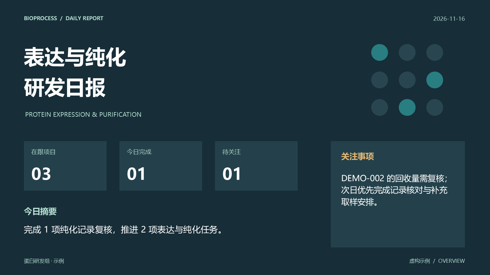
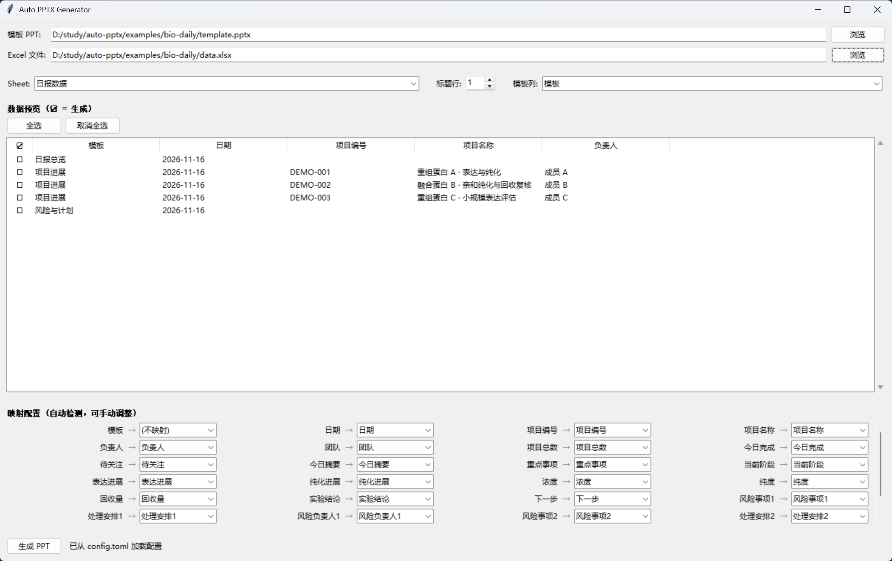
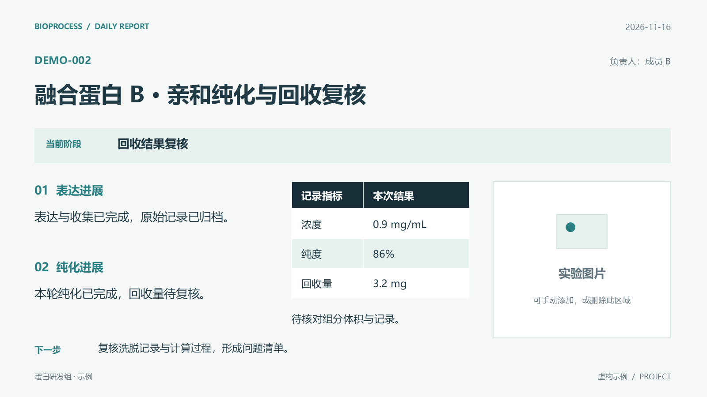
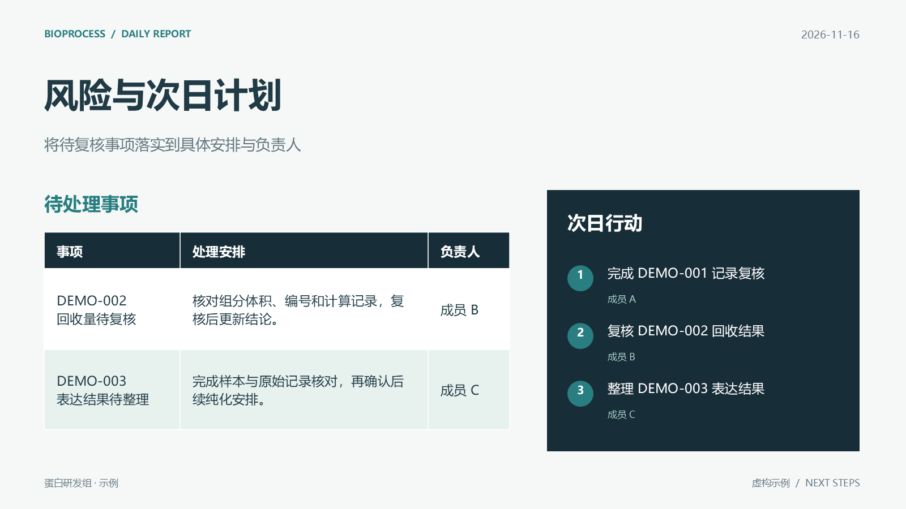

# 蛋白表达与纯化日报

用三页 PowerPoint 模板，将五行 Excel 数据生成五页日报。全部数据均为虚构示例。



## 示例文件

| 文件 | 内容 |
| --- | --- |
| [template.pptx](template.pptx) | 日报总览、项目进展、风险与计划三页模板 |
| [data.xlsx](data.xlsx) | 五行数据及“填写说明”工作表 |
| [sample-output.pptx](sample-output.pptx) | 生成器输出的五页成品 |
| [previews/](previews/) | 成品的五页预览 |

## 生成日报

下图为加载示例后的旧版 Windows 界面，尚未勾选数据行，也未显示“检查当前设置”。



1. 启动程序，分别点击“浏览”，选择本目录的 `template.pptx` 和 `data.xlsx`。
2. “Sheet”选“日报数据”，标题行设为 **1**，模板列选“模板”。
3. “模板”列选“(不映射)”，其余字段按同名映射，如“项目编号 → 项目编号”。保存的配置优先于自动建议，请逐项确认。
4. 点击“全选”，勾选 Excel 第 **2～6** 行，再点击“生成 PPT”。
5. 核对成品：**5 页**，无跳过行、模板未匹配或未替换占位符警告。

输出为本目录下的 `output_YYYYMMDD_HHMMSS.pptx`，内容对应 `sample-output.pptx`。

界面各区域、勾选和滚动操作见[界面说明](../../docs/使用培训.md#界面说明)。

## 填写数据

| Excel 行号 | 模板 | 字段 |
| --- | --- | --- |
| 2 | 日报总览 | 日期、团队、项目总数、今日完成、待关注、今日摘要、重点事项 |
| 3～5 | 项目进展 | 项目编号、项目名称、负责人、当前阶段、表达进展、纯化进展、浓度、纯度、回收量、实验结论、下一步 |
| 6 | 风险与计划 | 风险事项1～2、处理安排1～2、风险负责人1～2、次日任务1～3、次日负责人1～3 |

“日期”和“团队”用于所有页面。每行只需填写所选模板的字段，其余列可留空。新增项目时，复制一条“项目进展”行，再修改内容。

手动填写汇总数量、实验结论和状态。程序不跨行统计，也不根据数值或状态改变模板颜色。未测定指标请填“未测定”，避免将空白误读为零。

## 编辑模板

- **版式与字体**：16:9，微软雅黑。使用替代字体时，检查换行。
- **模板标识**：将 `{{tpl::日报总览}}` 等标识留在画布外，生成器会保留它们。
- **文字长度**：项目名称建议不超过 22 字；进展和结论不超过 32 字；下一步不超过 34 字。程序不会自动适配，请检查换行。
- **图片**：在模板或成品中手动插入，保持比例。可删除图片区提示和装饰。不同项目的图片需在成品对应页分别添加。
- **容量**：风险页固定两条事项和三项次日任务。需要更多空间时，新增 Excel 行并引用“风险与计划”，生成另一页。需要调整用途时，复制模板并修改标题或字段。





## 重建示例

在项目根目录运行：

```bash
uv run python -m scripts.build_bio_daily
```

此命令覆盖模板、Excel 和成品，**不更新预览图**。临时验证可指定其他目录：

```bash
uv run python -m scripts.build_bio_daily --output /tmp/auto-pptx-bio-daily
```

修改脚本后，重建三个文件，再从成品导出五页 PNG，替换 `previews/slide-01.png` 至 `slide-05.png`。手动修改模板时，也需同步脚本，避免重建时丢失改动。

模板与数据规则见[使用指南](../../docs/使用培训.md)。
