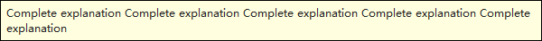
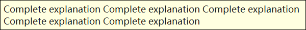

# 验证记录（2026-11-18）

首次布局修复已通过 Windows 和 Linux 源码回归。另一种操作系统 DPI 缩放和最终 exe 的验收仍待完成。

## 实现与测试

- Text 在 Map/Configure 后安排 idle 布局，使用实际宽度计算换行高度。隐藏、切换目标和销毁时取消待执行布局。
- 测试有超时地等待实际布局稳定，覆盖首次显示、短长交替、长文本滚动到底及完整内容保留。
- 新增 hide、destroy、目标改变时取消布局回调的三个用例。
- 真实指针测试先激活窗口，并确认指针实际位于源 Treeview，再按提示框实际位置逐像素跨入及离开。此前失败时坐标已位于提示框范围，但 `winfo_containing` 返回 None；窗口遮挡或未激活不应被当成应用的跨窗阅读结果。
- 新增 `--require-gui`，Tk 初始化失败按错误报告。无显示的独立进程检查确认不会退化为 skip。

Windows 原生文件描述符输出捕获下，复现了 Tk 初始化时读取存在的 Tcl 文件失败。改用 `--capture=sys` 后，提示框、GUI 联合及最终完整测试均未再出现此错误。CI 的 Windows 测试采用该捕获方式；不修改应用 Tcl 库路径，不删除文件，不扩大 skip。

旧的首次长文本负滚动比例未在布局稳定后重现。现在检查滚动比例、尾部内容可见及原始文本完整性；最终相关测试通过，不将此前的偶发负比例直接声明为独立已定位缺陷。

## 结果

| 平台与范围 | 结果 |
| --- | --- |
| Linux，Python 3.12.13，真实 Xvfb，提示框 | 13 passed |
| Windows，Python 3.12.13 AMD64、Tk 8.6.12，提示框，capture=sys | 13 passed |
| Windows，相同环境，GUI 布局与提示框联合 | 67 passed |
| Windows，相同环境，最终完整 suite，require-gui、capture=sys | 175 passed，无跳过 |
| Linux，Python 3.12.13，真实 Xvfb，最终完整 suite，require-gui | 175 passed，无跳过 |
| OpenSpec 全部严格校验 | 26 passed |

验收检查器复核后增加了图表工作簿关系断链和保存映射缺失两个损坏用例。最终复跑：Windows 完整 suite 177 passed（33.99 秒），Linux Xvfb 完整 suite 177 passed（7.42 秒），均无跳过；GUI 实现未在这次复核中改动。

Windows 短文本提示框的稳定尺寸为 600×46。另将 Tk 字体缩放从约 1.33 调至约 2.0，稳定尺寸为 600×60；已查看两张原生窗口截图，文本完整、自动换行、无多余滚动条。此检查改变的是 Tk 缩放，不等同于更改 Windows 系统 DPI 设置。

## 待验收

- 在另一种 Windows 操作系统显示缩放设置下人工检查提示框与真实指针。
- 使用最终 Windows exe 再验收生成行为。源码 suite 和合成检查器测试不代替成品验收。
